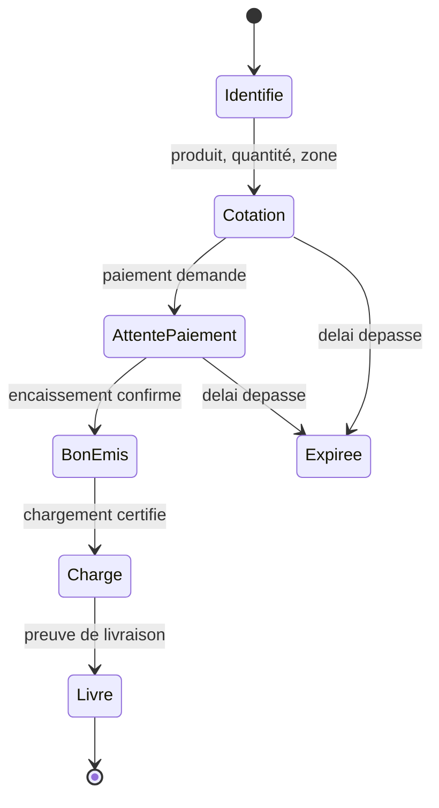

# A4 — Parité des canaux : cotation, paiement et bon sur les cinq canaux

> **Objet.** Un client doit pouvoir obtenir une cotation, payer et recevoir son bon **quel que soit le canal qu'il utilise** : WhatsApp, Telegram, e-mail, SMS ou USSD. Ce document dit ce que cela exige, ce que chaque canal permet réellement, et dans quel ordre le construire.

---

## 1. Le principe qui rend la parité possible

**Le canal est un transport, pas une fonctionnalité.**

Si chaque canal portait sa propre logique, il y aurait cinq vérités différentes sur le prix, cinq façons d'émettre un bon et cinq fois les mêmes bugs. Il faut donc :

1. **un seul moteur de parcours**, côté serveur : la session de commande, identifiée par le numéro de cotation ;
2. **cinq adaptateurs de rendu**, qui traduisent le même état dans la grammaire du canal.

Conséquence directe, et c'est l'argument à vendre : **un client peut commencer sur USSD et terminer sur WhatsApp**. C'est le même dossier, la même cotation, le même bon.

---

## 2. Matrice de parité

| Étape | WhatsApp | Telegram | E-mail | SMS | USSD |
|---|---|---|---|---|---|
| **Identification** | numéro + code à usage unique | identifiant + code | adresse + code, ou lien signé | numéro + code court | numéro de session + code à 4 chiffres |
| **Cotation** | carte avec boutons | clavier en ligne | PDF joint + lien signé | résumé en deux messages + code | écrans de menu numérotés |
| **Paiement** | lien ou ordre mobile money | identique | lien de paiement signé | mot-clé `PAY`, puis demande mobile money | demande mobile money ouverte dans la session |
| **Bon** | QR et PDF | fichier et QR | PDF et QR | **code de retrait** et lien | **code de retrait** |
| **Suivi** | notifications | notifications | e-mails d'état | `ETAT` + code | écran d'état |
| **Litige** | conversation puis agent | conversation puis agent | lien de déclaration | `LITIGE` + code | écran d'ouverture |
| **Reprise humaine** | à tout moment | à tout moment | réponse à l'e-mail | `AGENT` | écran « parler à un agent » |

**Les cinq canaux portent bien les trois étapes.** La différence est dans la forme du bon : SMS et USSD ne pouvant transporter ni image ni QR, le bon y devient un **code de retrait** que l'agent saisit. C'est une évolution de la console de chargement : *scanner un QR **ou** saisir un code*.

---

## 3. Les six invariants, identiques sur tous les canaux

| Réf. | Invariant |
|---|---|
| **INV-01** | Aucun prix n'est produit avant vérification de l'identité (RG-COT-01) |
| **INV-02** | La cotation est la référence de paiement (RG-COT-04) |
| **INV-03** | Le bon naît de l'encaissement, jamais d'un message (RG-CMD-01) |
| **INV-04** | Une identité, plusieurs canaux : le canal est un moyen de contact, pas un compte |
| **INV-05** | Chaque message et chaque action sont journalisés, quel que soit le canal |
| **INV-06** | Aucune position, aucun délai de règlement n'est annoncé s'il n'est pas connu |

---

## 4. Ce que chaque canal impose réellement

### 4.1 USSD — le canal qui marche sans internet

| Contrainte | Conséquence de conception |
|---|---|
| Session de 20 à 30 secondes, sans retour arrière | Quatre écrans au maximum entre le menu et la cotation ; tout ce qui peut attendre est renvoyé par SMS |
| Environ 182 caractères par écran | Aucune phrase explicative ; des libellés courts et des chiffres |
| Aucune image, aucun lien cliquable | Le bon devient un **code de retrait** ; l'état est consultable par un menu |
| Session perdue si le client décroche | **Reprise par code court envoyé en SMS** ; sans cela, le client recommence tout |
| Passerelle : Africa's Talking pour l'USSD et le SMS | **Africa's Talking ne collecte pas les fonds** : il faut un PSP ou un agrégateur derrière (Araka, ou une banque agrégateur) |

> **Point à trancher avant toute promesse :** sans PSP raccordé à l'USSD, le menu affiche un prix mais ne peut pas être payé. C'est la question Q-60.

### 4.2 SMS — le canal le plus contraint

| Contrainte | Conséquence de conception |
|---|---|
| 160 caractères par message, facturé à l'unité | Une commande complète tient en 4 à 6 messages : le coût doit être arbitré |
| Aucune pièce jointe, aucun QR | Le bon est un code ; le détail est envoyé sur demande (`BON`) |
| Pas de boutons | Une **grammaire de mots-clés** stable, documentée au client dès le premier message |
| Le client peut répondre n'importe quoi | Toute réponse non reconnue renvoie l'aide et propose `AGENT` |

### 4.3 Telegram — le canal le moins coûteux à ouvrir

| Contrainte | Conséquence de conception |
|---|---|
| Bot à créer, **aucun compte marchand à négocier** | C'est le canal le plus rapide à mettre en service techniquement |
| Population plus étroite en RDC | À positionner comme canal de service, pas d'acquisition |
| Claviers en ligne, fichiers, QR | Le parcours est identique à WhatsApp, seul le rendu change |

### 4.4 E-mail — le canal asynchrone

| Contrainte | Conséquence de conception |
|---|---|
| Aucune session : le client lit quand il veut | Tout passe par un **lien signé**, valable aussi longtemps que la cotation |
| Le lien doit authentifier sans mot de passe | Jeton propre au client et à la cotation ; un lien transféré ne donne aucun prix |
| Pièces jointes attendues par les entreprises | Cotation en PDF, reçu en PDF, dossier de preuve en PDF |
| Ne promet pas d'instantanéité | Annoncer un dossier complet, jamais une réponse immédiate |

### 4.5 WhatsApp — le canal de volume

| Contrainte | Conséquence de conception |
|---|---|
| Compte marchand validé, **gabarits soumis à approbation** | Un modèle par événement et par langue ; aucun message libre |
| Fenêtre de conversation de 24 heures | Les messages sortants hors fenêtre passent par un gabarit approuvé |
| Riche : boutons, médias, QR | Parcours complet dans le fil, bon en PDF avec QR |

---

## 5. Grammaire SMS et USSD

Une seule grammaire, deux supports. Elle est stable, testable, et affichée au client au premier message.

| Commande | Effet | Réponse |
|---|---|---|
| `COT <quantité> <zone>` | Ouvre une demande de cotation | Numéro de cotation, total, échéance de validité |
| `PAY <code>` | Demande le paiement de la cotation | Ouverture d'une demande mobile money sur le numéro |
| `BON <code>` | Renvoie le bon et son code de retrait | Bon, code, point de chargement, validité |
| `ETAT <code>` | Donne l'état de la commande | Étapes franchies, dernière position si transmise |
| `LITIGE <code>` | Ouvre un litige | Numéro de dossier, pièces attendues |
| `AGENT` | Demande une reprise humaine | Ticket, délai de rappel annoncé |
| `AIDE` | Réaffiche la grammaire | Liste des commandes |

---

## 6. La session de commande et la reprise inter-canaux

Trois règles de reprise :

1. **Le numéro de cotation est la clé de reprise**, quel que soit le canal d'arrivée.
2. **Une session USSD interrompue** envoie un code court par SMS pour reprendre au dernier écran atteint.
3. **Un changement de canal ne crée jamais un second dossier** : c'est le même bon, la même part de transport, la même preuve.

---

## 7. Dans quel ordre construire

| Phase | Canaux | Pourquoi cet ordre |
|---|---|---|
| **MVP** | Application et Web | Une seule chaîne de preuve à stabiliser, un seul front d'erreurs |
| **V1** | WhatsApp et e-mail | Les deux canaux qui portent le volume ; l'e-mail réutilise les liens signés du web |
| **V1.1** | Telegram | Bot rapide à ouvrir, aucun compte marchand, coût marginal faible |
| **V1.2** | SMS et USSD | Les seuls qui fonctionnent sans internet, mais les plus chers à construire **et** à exploiter |

> Les cinq canaux en V1 sont faisables — à condition de les chiffrer comme **cinq adaptateurs plus un moteur**, et non comme « un peu plus de travail ». C'est la question Q-61.

---

## 8. Ce que cela change dans les interfaces

| Interface | Changement |
|---|---|
| **IF-10** | Devient *Canaux conversationnels et textuels* : WhatsApp, Telegram, SMS et USSD, avec leurs écrans propres |
| **IF-11** (nouvelle) | E-mail transactionnel : cotation, lien signé, pièces jointes |
| **IF-05, CHG-02** | Accepte un **QR ou un code de retrait** : sans cela, les bons émis par SMS ou USSD ne peuvent pas être chargés |
| **IF-09, CNL-05** | Le bac à sable gagne un **test de parité** : un même scénario joué sur les cinq canaux avant ouverture |
| **IF-01, CLI-16** | Le client voit et gère ses canaux rattachés sur un même compte |
