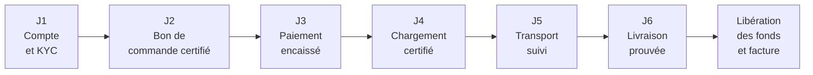
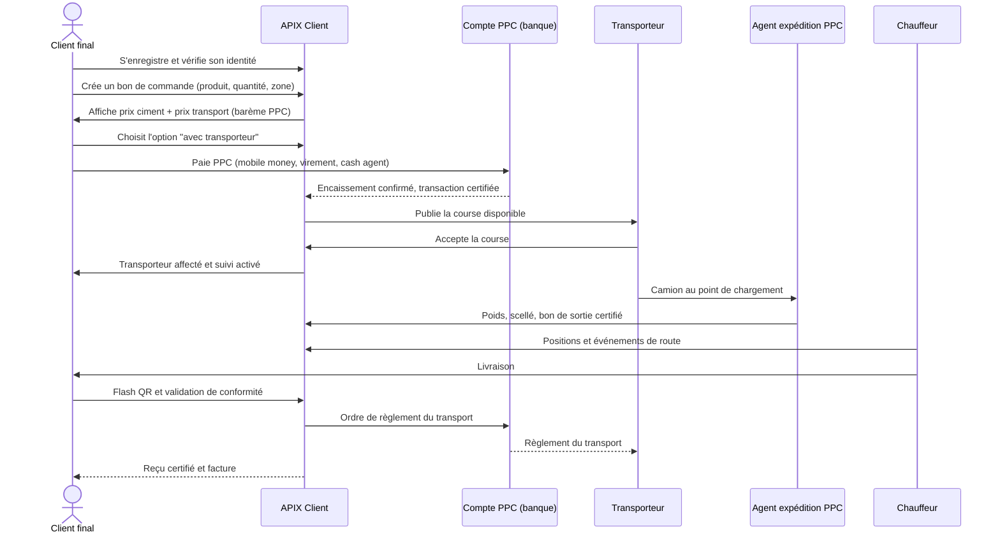

# 01 — Note de cadrage

**Extension APIX — Plateforme Clients Finaux & Logistique Ciment**
FBB pour PPC · version 1.0 · 4 novembre 2026

---

## Sommaire

1. [Contexte et enjeux](#1-contexte-et-enjeux)
2. [Revue critique de l'idée initiale](#2-revue-critique-de-lidée-initiale)
3. [Vision et proposition de valeur](#3-vision-et-proposition-de-valeur)
4. [Acteurs et rôles](#4-acteurs-et-rôles)
5. [Parcours cibles](#5-parcours-cibles)
6. [Périmètre et découpage temporel](#6-périmètre-et-découpage-temporel)
7. [Exigences non fonctionnelles](#7-exigences-non-fonctionnelles)
8. [Risques et parades](#8-risques-et-parades)
9. [Hypothèses et dépendances](#9-hypothèses-et-dépendances)
10. [Gouvernance et jalons](#10-gouvernance-et-jalons)
11. [Indicateurs de succès](#11-indicateurs-de-succès)
12. [Glossaire](#12-glossaire)

---

## 1. Contexte et enjeux

### 1.1 La situation actuelle

**FBB** a conçu **APIX**, plateforme de **certification des transactions de paiement CIMA** appliquée aux comptes de **PPC**. APIX est donc aujourd'hui une brique de confiance **financière** : elle atteste qu'une transaction est authentique, conforme et traçable.

**PPC**, cimentier, dispose par ailleurs d'un collaborateur technologique, **Digiciment**, qui opère :

- une application de **petites transactions** destinée aux petits clients finaux ;
- un **module logistique léger** de gestion de la livraison.

### 1.2 Le besoin exprimé

FBB souhaite **étendre APIX** pour couvrir la chaîne complète de la vente de ciment :

1. une application **Android, iOS et Web** permettant au client final de PPC de **s'enregistrer**, de **créer des bons de commande** et de **payer son ciment** ;
2. un **historique d'achats** consultable par le client final ;
3. une **couche logistique complète**, traitant la douleur réelle du client final ;
4. une **mise en relation** entre clients finaux et **transporteurs partenaires**, ces transporteurs étant **homologués par l'administration de PPC** — précision essentielle : **les transporteurs ne sont pas PPC, ce sont des partenaires tiers** ;
5. trois **options d'achat** : *sans transporteur*, *avec transporteur*, *autre* ;
6. en cas d'achat avec transporteur : **désignation du point de livraison et de l'itinéraire** ;
7. la **gestion des engins de transport** et du **transport interurbain** de ville à ville.

### 1.3 L'enjeu stratégique

Il est explicitement double :

- **gagner et conserver le marché** face à Digiciment ;
- **rendre APIX indispensable** à PPC en devenant la couche d'intégration entre la finance et la supply chain.

---

## 2. Revue critique de l'idée initiale

Cette section est volontairement directe. Elle a pour objet de renforcer le dossier avant qu'il ne soit présenté à PPC, non de le fragiliser.

### 2.1 Forces de l'approche

| Force | Pourquoi cela compte |
|---|---|
| **Verrouillage de l'écosystème** | Réunir certification financière et supply chain rend le remplacement d'APIX structurellement coûteux |
| **PPC reprend le contrôle de son image** | Homologuer les transporteurs, c'est refuser que la mauvaise livraison d'un tiers abîme la marque PPC |
| **Flexibilité des trois options** | Respecte les habitudes réelles du marché (enlèvement, livraison, arrangements particuliers) au lieu de les combattre |
| **Continuité avec l'existant** | APIX est déjà en production sur les comptes PPC : il n'y a pas de « changement d'outil » à faire accepter, seulement une extension |

### 2.2 Point de vigilance n° 1 — Le risque de sur-périmètre

Le périmètre décrit contient **quatre produits** :

1. une application grand public (client final) ;
2. une application professionnelle terrain (transporteur / chauffeur) ;
3. un back-office d'homologation et de pilotage (PPC) ;
4. un moteur logistique (barèmes, groupage, tournées, preuve de livraison).

Livrer les quatre simultanément est irréaliste. **Recommandation :** construire d'abord la **chaîne de preuve** (commande → paiement → chargement → livraison) sur un périmètre étroit, et n'ajouter le groupage qu'une fois la preuve de livraison fiable et acceptée par les transporteurs.

### 2.3 Point de vigilance n° 2 — « Client final » recouvre trois populations distinctes

Le mot « client final » masque trois segments aux besoins contradictoires :

| Segment | Ce qu'il achète | Ce qu'il attend de l'application | Contrainte dominante |
|---|---|---|---|
| **Dépôt / revendeur de quartier** | 50 à 500 sacs, récurrent | Réapprovisionnement rapide, prix stable, crédit | Trésorerie, rotation de stock |
| **Entreprise / chantier** | 200 à 3 000 sacs, par projet | Facture conforme, traçabilité, respect du planning de chantier | Comptabilité, fiscalité, délais |
| **Particulier / artisan** | 5 à 50 sacs, ponctuel | Prix total connu d'avance, livraison simple, preuve d'achat | Cash, pas de smartphone haut de gamme, méfiance |

Un seul parcours ne servira correctement aucun des trois. **Recommandation :** un socle commun, mais trois **profils de compte** avec des parcours et des plafonds différenciés.

### 2.4 Point de vigilance n° 3 — Le tracé d'itinéraire par le client est un piège d'usage

Demander au client final de « tracer l'itinéraire » sur une carte est irréaliste hors des grands centres : adressage informel, quartiers sans nom de rue, réseau instable, téléphones d'entrée de gamme.

**Recommandation :**

- remplacer le tracé libre par une **zone de livraison normalisée** (ville / commune / quartier / secteur) définie par PPC ;
- ajouter un **point de repère textuel obligatoire** (« en face du grand manguier, après l'école Saint-Joseph ») ;
- rendre la **position GPS optionnelle**, jamais bloquante ;
- permettre à PPC de **définir des points de rendez-vous logistiques** (dépôt, marché, station) pour les zones non desservies à domicile.

Le tracé d'itinéraire devient alors un outil du **transporteur**, pas une obligation du client.

### 2.5 Point de vigilance n° 4 — L'argent : un circuit qui n'est pas un séquestre

Le circuit réel est le suivant : **l'argent quitte le compte du client vers PPC avant même que le transporteur ne voie la commande**. Le transport est donc une dépense de PPC, pas un paiement du client au transporteur. Confondre les deux conduit à promettre une protection que le circuit ne permet pas.

Trois conséquences à écrire noir sur blanc avant toute ligne de code :

1. **Ce que le client achète** : une commande et un transport, payés à PPC. Sa protection n'est pas un gel de ses fonds, mais un **dossier de preuve** et une réclamation opposable.
2. **Ce que PPC doit** : régler le transporteur, **mais uniquement lorsque l'offre vendue comprend le transport**. Le levier d'APIX est de **conditionner ce règlement à la preuve de livraison**, et de permettre une retenue partielle sur la course concernée. Une offre sans transport ne crée aucune dette envers un transporteur.
3. **Ce que FBB ne fait pas** : APIX n'exécute aucun paiement et ne détient aucun fonds. Il instruit, certifie et trace.

**Recommandation :** abandonner le mot « séquestre » dans la communication. Parler d'**encaissement certifié** et de **règlement conditionné par la preuve**. Le mot « séquestre » promet une protection que le circuit réel ne permet pas, et crée une attente juridique que PPC ne pourrait pas tenir.

### 2.6 Point de vigilance n° 5 — Le prix du transport doit être un barème, pas une négociation

Si le prix du transport reste négociable dans l'application, APIX ne fait que déplacer la spéculation sur un autre canal. Le levier de valeur — « PPC reprend le contrôle du prix final » — disparaît.

**Recommandation :** un **barème publié par PPC**, versionné et daté, appliqué automatiquement. Toute dérogation est tracée, nominative et limitée dans le temps.

### 2.7 Point de vigilance n° 6 — La responsabilité juridique de l'homologation

Faire valider les transporteurs par PPC crée un risque : en cas d'accident ou de vol, un client peut soutenir que PPC a « choisi » le transporteur et donc répondu de sa faute.

**Recommandation :** trois mesures simples.

1. Qualifier juridiquement PPC comme **organisme d'homologation**, pas comme transporteur ni comme mandant.
2. Écrire un **contrat tripartite** (client final, transporteur, PPC/APIX) qui isole la responsabilité de chacun.
3. Exiger du transporteur une **assurance responsabilité civile marchandises** en cours de validité, contrôlée et suivie dans le back-office (alerte avant échéance).

### 2.8 Point de vigilance n° 7 — Le litige le plus fréquent n'est pas le retard, c'est l'écart de poids

Sur le ciment, les contentieux réels portent sur : **sacs manquants**, **sacs mouillés ou déchirés**, **ciment pris en masse**. La réponse doit être **contradictoire et documentée** :

- **poids au chargement** (ticket de pesée),
- **poids à la livraison** (pesée ou comptage contradictoire),
- **tolérance** définie contractuellement,
- **photos horodatées et géolocalisées** à chaque étape,
- **numéro de scellé** relevé au chargement et vérifié à l'arrivée.

Sans ces cinq éléments, APIX ne peut pas arbitrer et se retrouve juge d'une parole contre une autre.

### 2.9 Point de vigilance n° 8 — Le mode déconnecté n'est pas une option

Entre deux villes, le réseau tombe. Un chauffeur qui perd la connexion ne doit pas perdre sa course.

**Recommandation :** le parcours chauffeur doit fonctionner **hors ligne** pendant au moins 72 heures, avec synchronisation différée et preuve de livraison stockée localement (QR, photo, horodatage). Côté client final, prévoir un **repli SMS / USSD** pour les notifications essentielles.

### 2.10 Point de vigilance n° 9 — Le risque de conflit de canal

PPC vend largement par un réseau de **dépôts et revendeurs**. Une application qui vend directement au particulier peut être perçue comme une **désintermédiation** du réseau, et se heurter à une résistance commerciale interne.

**Recommandation :** positionner l'application comme **complémentaire** :

- intégrer les dépôts agréés comme **points de retrait** dans l'application ;
- leur donner un **accès dédié** (réapprovisionnement, tarifs, visibilité) ;
- ne jamais casser leur marge sans décision explicite de PPC.

C'est aussi un argument face à Digiciment : **APIX renforce le réseau existant, Digiciment le contourne.**

### 2.11 Point de vigilance n° 10 — Le cash reste roi

Une part importante des transactions se règle en espèces. Si l'application n'accepte que le paiement électronique, elle exclut la majorité du marché adressable.

**Recommandation :** prévoir un **circuit d'encaissement cash traçable** :

- dépôt chez un **agent de proximité agréé** (qui saisit la référence de commande dans l'application) ;
- dépôt en **banque partenaire** au guichet avec référence ;
- **recharge de wallet** par un tiers mandaté, dans la limite des règles de lutte contre le blanchiment.

### 2.12 Point de vigilance n° 11 — Le vocabulaire produit doit être verrouillé

« Bon de commande », « bordereau », « bon de livraison », « bon de sortie », « fiche de chargement » ne désignent pas la même chose selon les interlocuteurs. Avant tout développement, un **lexique officiel** doit être arrêté avec PPC (voir le glossaire, section 12). C'est une source classique d'échec de projet.

### 2.13 Point de vigilance n° 12 — La concurrence ne doit pas être sous-estimée sur son terrain

Digiciment est déjà présent sur les **petites transactions**. Attaquer frontalement sur ce terrain, c'est jouer à domicile chez l'adversaire. Le terrain où APIX est imbattable est **la preuve et la responsabilité** : dossier de litige complet, règlement conditionné, homologation, barème opposable.

**Recommandation :** ne pas se battre sur « nous faisons aussi les petits paiements », mais sur « nous sommes les seuls à pouvoir prouver ce qui s'est passé ».

---

## 3. Vision et proposition de valeur

### 3.1 Énoncé de vision

> **APIX : la chaîne de preuve du ciment, du paiement à la livraison.**
> Un identifiant client, un bon de commande certifié, un paiement encaissé et certifié, un chargement documenté, une livraison prouvée — et la certitude, pour chacun, de savoir où se trouve sa responsabilité.

### 3.2 La chaîne de preuve en six jalons

C'est le squelette fonctionnel de tout le produit. Chaque jalon produit une preuve, et chaque preuve conditionne le jalon suivant.

| Jalon | Preuve produite | Ce que cela débloque |
|---|---|---|
| **J1 — Compte et KYC** | Identité vérifiée, profil de compte, plafonds | Accès aux prix, plafonds de commande, conformité |
| **J2 — Bon de commande certifié** | Bon signé, numéro unique, QR nominatif | Réservation du stock, engagement réciproque |
| **J3 — Paiement encaissé** | Transaction certifiée APIX, part transport identifiée | La course peut être engagée : PPC est solvable, le règlement est conditionné |
| **J4 — Chargement certifié** | Ticket de pesée, numéro de scellé, photo | Le poids de départ devient une référence opposable |
| **J5 — Transport suivi** | Positions, événements, incidents | Le client sait où est son ciment ; PPC sait où est son camion |
| **J6 — Livraison prouvée** | QR flashé, photo géolocalisée, conformité signée | Libération des fonds, clôture du litige potentiel |
| **J7 — Facture et historique** | Reçu certifié, facture, historique | Comptabilité, fiscalité, fidélisation |

### 3.3 Les trois options d'achat

| Option | Description | Qui organise le transport | Ce qui change dans le parcours |
|---|---|---|---|
| **Option A — Sans transporteur** | Le client vient chercher le ciment, ou mandate son propre transporteur | Le client | Génération d'un **bon de sortie** à présenter au point de chargement ; pas de règlement de transport |
| **Option B — Avec transporteur** | APIX organise le transport avec un partenaire homologué PPC | APIX / PPC | Choix de la zone de livraison, calcul du barème, affectation d'un transporteur, suivi et preuve de livraison |
| **Option C — Autre** | Cas particuliers : retrait en dépôt agréé, enlèvement par un tiers mandaté, transport fourni par le client | Variable, validé par PPC | Parcours paramétrable, validé au cas par cas dans le back-office |

> **Recommandation :** ne pas laisser l'option C entièrement libre. Un **catalogue de cas** paramétrés par PPC, avec un motif obligatoire, évite qu'elle ne devienne une porte de sortie qui contourne le barème.

### 3.4 Ce que le produit refuse de faire (garde-fous)

Ces refus sont des arguments de crédibilité devant PPC.

1. **Ne jamais afficher un prix de transport non validé par PPC.**
2. **Ne jamais libérer des fonds sans preuve de livraison ou décision explicite de PPC.**
3. **Ne jamais homologuer un transporteur sans pièces justificatives complètes et valides.**
4. **Ne jamais supprimer une preuve** : toute correction est un nouvel événement, jamais un effacement.

---

## 4. Acteurs et rôles

### 4.1 Cartographie des acteurs

| Code | Acteur | Description | Application utilisée |
|---|---|---|---|
| **AC-CLI** | Client final PPC | Acheteur de ciment : dépôt, entreprise, particulier | Application mobile / Web client |
| **AC-TRP** | Transporteur partenaire | Entreprise de transport tierce homologuée par PPC | Portail transporteur (Web) |
| **AC-CHF** | Chauffeur | Agent du transporteur, exécute la course | Application mobile chauffeur |
| **AC-EXP** | Agent d'expédition / chargement | Opérateur PPC au point de chargement (usine ou dépôt) | Console de chargement (Web / tablette) |
| **AC-ADM** | Administrateur PPC | Homologation, barèmes, litiges, pilotage | Back-office PPC |
| **AC-FIN** | Contrôleur financier PPC | Suivi des provisions de transport, des règlements et des retenues, rapprochements | Back-office PPC (lecture + actions) |
| **AC-DEP** | Dépôt / point de retrait agréé | Canal existant intégré comme point de retrait | Console dépôt (Web / mobile) |
| **AC-FBB** | Super-administrateur APIX | Supervision technique, support, configuration | Console d'exploitation APIX |
| **AC-BNK** | Banque / établissement de paiement | Encaisse les paiements clients pour PPC et exécute les règlements vers les transporteurs | Intégration (pas d'interface utilisateur) |

### 4.2 Matrice des responsabilités (RACI simplifié)

| Activité | Client final | Transporteur | PPC (administration) | FBB / APIX | Banque |
|---|---|---|---|---|---|
| Création du compte | Réalise | — | Valide les profils sensibles | Fournit le service | Vérifie le KYC réglementaire |
| Homologation d'un transporteur | — | Fournit les pièces | **Décide** | Outille le contrôle | — |
| Publication du barème | — | Consulte | **Décide** | Applique | — |
| Affectation d'une course | Choisit l'option | Accepte la course | Arbitre les conflits | Propose (algorithme) | — |
| Preuve de chargement | — | Présente le camion | **Certifie** (agent d'expédition) | Enregistre | — |
| Preuve de livraison | Valide la réception | Réalise la livraison | Arbitre en cas de litige | Enregistre | — |
| Libération des fonds | Reçoit ou conteste | Reçoit | Autorise les cas litigieux | Déclenche | **Exécute** |
| Traitement d'un litige | Déclare | Répond | **Tranche** | Instruit le dossier | Exécute la décision |

---

## 5. Parcours cibles

Trois parcours suffisent à structurer le MVP.

### 5.1 Parcours A — Commande avec transporteur (parcours nominal)

### 5.2 Parcours B — Enlèvement sans transporteur

1. Le client crée un bon de commande et choisit **Option A**.
2. Il paie ; un **bon de sortie certifié** est généré avec QR.
3. Le client (ou son transporteur mandaté) se présente au point de chargement.
4. L'agent d'expédition **flashe le QR**, enregistre le poids et le scellé.
5. Le bon est clôturé ; l'historique est mis à jour.

> Point de contrôle : le bon de sortie doit être **nominatif et à usage unique**. C'est la principale protection contre le détournement de bons — un bon revendu deux fois est la fraude la plus coûteuse du modèle.

### 5.3 Parcours C — Groupage (V1, hors MVP)

1. Le client commande une quantité inférieure au seuil de rentabilité d'un camion dédié.
2. L'application lui propose le **groupage** : coût réduit, contre un délai d'attente.
3. Les fonds sont cantonnés ; la commande rejoint un **lot en constitution** sur son axe.
4. Quand le lot atteint le seuil de remplissage, une course est publiée aux transporteurs.
5. Le chauffeur reçoit une **feuille de route multi-arrêts** ; l'ordre de chargement suit la règle du dernier livré / premier chargé.
6. Chaque client valide sa réception ; le paiement du transporteur est libéré au prorata des livraisons conformes.

Le détail des règles (délai de validité du lot, prorata, annulation, ré-tarification) figure en annexe A1, section 6.

---

## 6. Périmètre et découpage temporel

### 6.1 Dans le périmètre

| Domaine | Contenu |
|---|---|
| **Compte client** | Inscription, vérification d'identité, profils (dépôt, entreprise, particulier), plafonds |
| **Commande** | Catalogue ciment, prix, bon de commande certifié, trois options d'achat |
| **Paiement** | Mobile money, virement, espèces via agent, encaissement certifié, règlement du transport sur preuve |
| **Logistique** | Zones de livraison, barème PPC, engins, affectation, suivi, preuve de livraison |
| **Transporteurs** | Portail transporteur, candidature, homologation, documents, score |
| **Chauffeur** | Application mobile hors-ligne, feuille de route, preuves |
| **Chargement** | Console d'expédition, pesée, scellé, bon de sortie |
| **Back-office PPC** | Transporteurs, barèmes, litiges, tableau de bord, exports |
| **Historique** | Achats, livraisons, reçus, factures, réclamations |

### 6.2 Hors périmètre (assumé et documenté)

| Élément exclu | Raison | Conséquence à assumer |
|---|---|---|
| Gestion de la flotte propre de PPC | Non mentionnée comme besoin ; sujet distinct | À réévaluer si PPC possède des camions |
| Achats de matières premières ou de clinker | Hors chaîne de distribution | Aucune |
| Crédit à la consommation et financement | Nécessite agrément et scoring mature | Préparer la donnée pour une V2 |
| Gestion des ressources humaines des transporteurs | Hors compétence | Aucune |
| Pilotage de la production usine | APIX informe, ne pilote pas | Prévoir un export pour la planification |
| Comptabilité générale de PPC | APIX produit des pièces, pas la comptabilité | Prévoir l'export comptable |

### 6.3 Découpage temporel

| Version | Contenu | Objectif |
|---|---|---|
| **MVP** | Chaîne de preuve J1 → J7, option A et option B, barème simple, preuve de livraison, back-office minimal | Prouver que la chaîne fonctionne sur un axe |
| **V1** | Groupage inter-clients, multi-arrêts, score transporteur, litiges partiels automatisés, facturation normalisée | Généraliser et rentabiliser |
| **V2** | Repli USSD / agents de proximité, crédit et fidélité, prévision de demande, place de marché logistique étendue | Étendre la couverture et la valeur |

---

## 7. Exigences non fonctionnelles

| Réf. | Exigence | Cible | Justification |
|---|---|---|---|
| **ENF-PERF-01** | Temps de réponse des interfaces de consultation | 95 % des requêtes sous 800 ms | Usage terrain, patience limitée |
| **ENF-DISP-01** | Disponibilité du service (heures ouvrées PPC) | 99,5 % mensuel | Un bon de commande bloqué immobilise un camion |
| **ENF-OFFL-01** | Fonctionnement hors ligne du parcours chauffeur | 72 heures minimum, synchronisation différée | Coupures réseau entre villes |
| **ENF-SECU-01** | Signature cryptographique des bons et preuves de livraison | Obligatoire, non contournable | Empêche la falsification et le rejeu |
| **ENF-SECU-02** | Journal d'audit inaltérable | Conservation 10 ans | Preuve en cas de contentieux |
| **ENF-CONF-01** | Protection des données personnelles | Minimisation, chiffrement au repos et en transit | Conformité et confiance |
| **ENF-INTE-01** | Idempotence des opérations financières | 100 % des écritures rejouables sans double effet | Évite les doubles débits |
| **ENF-LANG-01** | Interface disponible en français | Français, avec terminologie PPC validée | Adoption |
| **ENF-ACCS-01** | Utilisable sur téléphone d'entrée de gamme | Android 8 minimum, 2 Go de RAM, mode économie de données | Réalité du parc installé |
| **ENF-SCAL-01** | Capacité de montée en charge | 10 000 commandes par mois sans refonte | Trajectoire de croissance |

---

## 8. Risques et parades

| Réf. | Risque | Impact | Probabilité | Parade |
|---|---|---|---|---|
| **R-01** | Adoption insuffisante des transporteurs partenaires | Élevé | Moyenne | Paiement rapide garanti, courses pleines, onboarding accompagné, pilote avec transporteurs déjà connus de PPC |
| **R-02** | Fraude au bon de commande (revente, réutilisation) | Très élevé | Moyenne | Bon nominatif à usage unique, QR signé, contrôle systématique au chargement, détection de doublons |
| **R-03** | Litige de poids non arbitrable | Élevé | Élevée | Pesée contradictoire obligatoire, tolérance contractuelle, photos et scellés |
| **R-04** | Rejet commercial par le réseau de dépôts | Élevé | Moyenne | Intégration des dépôts comme points de retrait, décision explicite de PPC sur les marges |
| **R-05** | Rejet par le conseil juridique du circuit d'encaissement et de règlement | Très élevé | Moyenne | Validation écrite du circuit avant développement, convention avec la banque de PPC |
| **R-06** | Couverture réseau insuffisante | Moyen | Élevée | Mode hors ligne, repli SMS / USSD, points de rendez-vous logistiques |
| **R-07** | Concurrence active de Digiciment sur les comptes PPC | Élevé | Moyenne | Différenciation par la preuve, verrouillage contractuel, arguments de la note commerciale |
| **R-08** | Dépendance à une seule banque ou un seul opérateur mobile money | Moyen | Moyenne | Abstraction technique, au moins deux fournisseurs par fonction critique |
| **R-09** | Dérive du périmètre en cours de projet | Moyen | Élevée | Découpage MVP / V1 / V2 opposable, comité d'arbitrage mensuel |
| **R-10** | Écart entre le barème théorique et le coût réel constaté | Élevé | Élevée | Revue trimestrielle du barème, indicateur d'écart, procédure de révision |
| **R-11** | Perte de données de preuve (téléphone volé, casse) | Élevé | Moyenne | Envoi immédiat des preuves au serveur dès retour du réseau, stockage local chiffré |
| **R-12** | Conflit de responsabilité PPC / transporteur | Élevé | Moyenne | Contrat tripartite, assurance marchandises obligatoire, statut d'organisme d'homologation |

---

## 9. Hypothèses et dépendances

### 9.1 Hypothèses à confirmer

| Réf. | Hypothèse | À confirmer par |
|---|---|---|
| H-01 | PPC dispose ou peut publier un barème logistique par axe et par engin | Direction commerciale PPC |
| H-02 | Les transporteurs partenaires acceptent un paiement après preuve de livraison | Direction logistique PPC |
| H-03 | PPC peut mobiliser un agent d'expédition par point de chargement | Direction opérations PPC |
| H-04 | La banque de PPC accepte d'exécuter les règlements transporteurs sur instruction d'APIX | Direction financière PPC / FBB |
| H-05 | Les paiements mobiles sont possibles sur les zones visées | Partenaires de paiement |
| H-06 | PPC autorise l'intégration des dépôts agréés comme points de retrait | Direction commerciale PPC |
| H-07 | Les données clients peuvent être hébergées hors du territoire national, ou à défaut localement | Conseil juridique PPC |

### 9.2 Dépendances externes

- **Interface APIX existante** (certification CIMA) : contrat d'interface documenté.
- **Opérateurs de paiement mobile** : au moins deux opérateurs.
- **Banque partenaire** : encaissement des paiements clients et exécution des règlements.
- **Passerelle SMS** et messagerie WhatsApp Business.
- **Service de cartographie** : fonds de carte et géocodage des zones.
- **Fiscalité** : format de facture normalisée en vigueur.

---

## 10. Gouvernance et jalons

### 10.1 Instances

| Instance | Fréquence | Participants | Objet |
|---|---|---|---|
| **Comité de pilotage** | Mensuel | Direction PPC, direction FBB | Arbitrages de périmètre, budget, risques majeurs |
| **Comité produit** | Hebdomadaire | Product owner, métier PPC, lead technique | Priorisation du backlog, validation des parcours |
| **Comité logistique** | Bimensuel | Direction logistique PPC, transporteurs représentatifs | Barèmes, litiges, qualité de service |
| **Revue de sécurité et conformité** | Trimestriel | DSI PPC, conseil juridique, FBB | Circuit de règlement, données, audit |

### 10.2 Jalons

| Jalon | Contenu | Durée | Critère de sortie |
|---|---|---|---|
| **J-0 Cadrage** | Ateliers métier, décisions D1 à D5, lexique, barème initial | 3 semaines | Décisions signées par PPC |
| **J-1 Conception** | Parcours détaillés, maquettes, modèle de données, architecture | 3 semaines | Validation formelle des maquettes |
| **J-2 Développement MVP** | Chaîne de preuve complète, back-office minimal | 10 à 12 semaines | Démonstration de bout en bout |
| **J-3 Pilote** | Un axe, un produit, 5 à 10 transporteurs | 4 semaines | 100 livraisons réelles sans incident bloquant |
| **J-4 Généralisation V1** | Groupage, multi-arrêts, score transporteur | 8 semaines | Ouverture à un deuxième axe |

---

## 11. Indicateurs de succès

| Réf. | Indicateur | Définition | Cible à 6 mois |
|---|---|---|---|
| **KPI-01** | Taux de commandes dématérialisées | Part des commandes passées dans APIX sur le total de l'axe pilote | ≥ 40 % |
| **KPI-02** | Taux de service logistique (OTIF) | Livraisons complètes et à l'heure / livraisons totales | ≥ 85 % |
| **KPI-03** | Taux de litige | Dossiers litigieux / livraisons | ≤ 3 % |
| **KPI-04** | Délai de règlement du transporteur | Temps entre preuve de livraison et règlement effectif | À fixer avec PPC après mesure du délai actuel |
| **KPI-05** | Taux de remplissage des camions groupés | Charge réelle / capacité | ≥ 85 % |
| **KPI-06** | Écart de coût logistique au sac | Coût APIX vs coût informel constaté antérieurement | Réduction ≥ 15 % |
| **KPI-07** | Taux de bons non utilisés | Bons émis et jamais présentés au chargement | ≤ 2 % |
| **KPI-08** | Satisfaction client final | Note moyenne en fin de livraison | ≥ 4 sur 5 |
| **KPI-09** | Transporteurs actifs | Transporteurs ayant réalisé au moins 3 courses dans le mois | ≥ 15 |
| **KPI-10** | Adoption du suivi | Clients consultant le suivi au moins une fois | ≥ 60 % |

---

## 12. Glossaire

Le vocabulaire doit être arrêté avec PPC avant tout développement. Les définitions ci-dessous sont des propositions.

| Terme | Définition proposée |
|---|---|
| **APIX** | Plateforme de certification des transactions conçue par FBB ; socle du présent projet |
| **Axe logistique** | Liaison routière de référence entre un point de chargement et une zone de livraison, dotée d'une distance et d'un barème |
| **Barème logistique** | Grille tarifaire officielle publiée par PPC, appliquée automatiquement selon l'axe, le poids et le type d'engin |
| **Bon de commande** | Document numérique certifié par APIX matérialisant une commande payée ; support du droit de retrait ou de livraison |
| **Bon de sortie** | Variante du bon de commande utilisée pour l'enlèvement sans transporteur |
| **Bon de livraison** | Document constatant la remise effective de la marchandise au client final |
| **Certification** | Acte par lequel APIX atteste l'authenticité et la conformité d'une transaction ou d'une preuve |
| **Digiciment** | Application de petites transactions et de logistique légère, présente chez PPC |
| **Engin** | Véhicule de transport caractérisé par sa charge utile, son type de caisse et son gabarit |
| **Groupage** | Mutualisation de plusieurs commandes de petits volumes dans un même camion pour en réduire le coût unitaire |
| **Homologation** | Acte administratif par lequel PPC autorise un transporteur à recevoir des courses dans APIX |
| **Jalon** | Étape de la chaîne de preuve produisant une preuve et conditionnant la suivante |
| **PPC** | Cimentier client, donneur d'ouvrage du présent projet |
| **Preuve de livraison** | Ensemble des éléments constatant la remise : QR nominatif, photo géolocalisée, horodatage, conformité, scellé |
| **Règlement conditionné** | Versement du transport au transporteur, déclenché par la preuve de livraison conforme |
| **Scellé** | Dispositif numéroté fermant le chargement, dont le numéro est relevé au départ et vérifié à l'arrivée |
| **TTL (durée de vie)** | Délai maximal pendant lequel un lot de groupage reste ouvert avant arbitrage |
