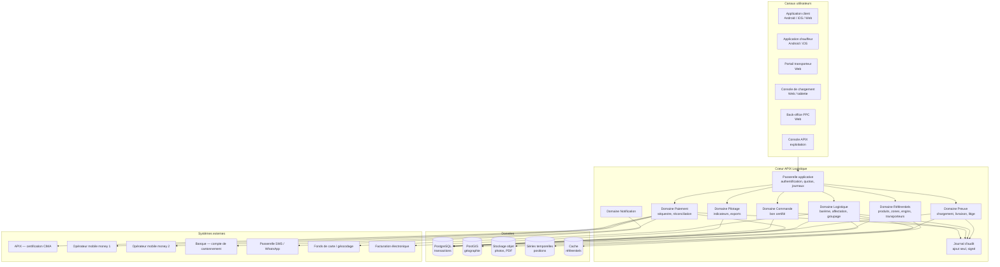
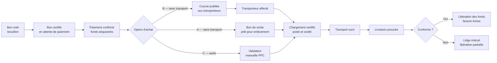
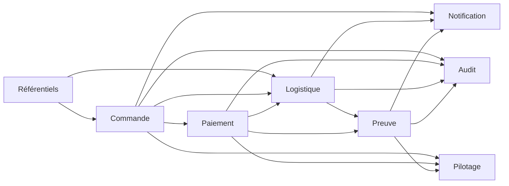
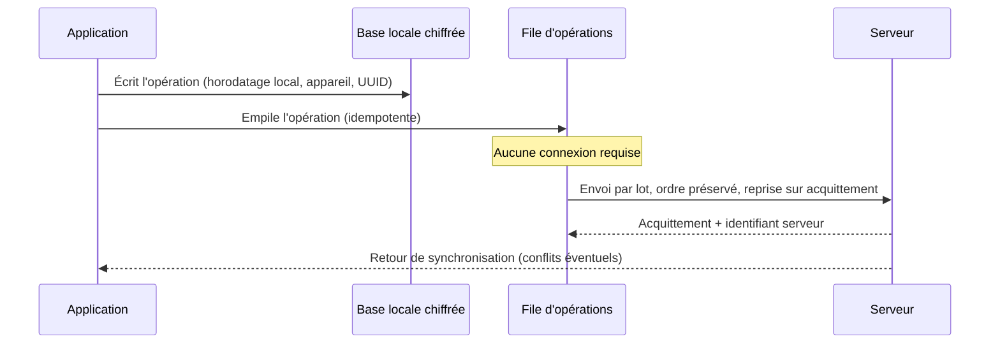
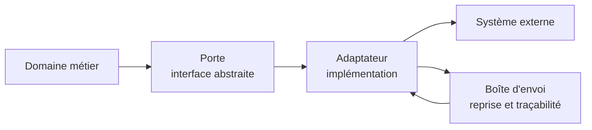

# 03 — Architecture technique

**Extension APIX — Plateforme Clients Finaux & Logistique Ciment**
FBB pour PPC · version 1.0 · 4 novembre 2026

---

## Sommaire

1. [Principes directeurs](#1-principes-directeurs)
2. [Vue d'ensemble](#2-vue-densemble)
3. [Choix technologiques](#3-choix-technologiques)
4. [Découpage applicatif](#4-découpage-applicatif)
5. [Modèle de données](#5-modèle-de-données)
6. [Surface d'interface applicative](#6-surface-dinterface-applicative)
7. [Stratégie hors-ligne et synchronisation](#7-stratégie-hors-ligne-et-synchronisation)
8. [Intégrations externes](#8-intégrations-externes)
9. [Sécurité, signature et audit](#9-sécurité-signature-et-audit)
10. [Performance, capacité et coûts d'exploitation](#10-performance-capacité-et-coûts-dexploitation)
11. [Environnements, industrialisation et exploitation](#11-environnements-industrialisation-et-exploitation)
12. [Décisions d'architecture ouvertes](#12-décisions-darchitecture-ouvertes)

---

## 1. Principes directeurs

Ces dix principes arbitrent toutes les décisions techniques. Ils doivent être cités en revue d'architecture.

| Réf. | Principe | Conséquence concrète |
|---|---|---|
| **P-01** | **La preuve avant la fonctionnalité** | Aucun écran n'est livré sans que la preuve associée soit signée et archivable |
| **P-02** | **Une seule source de vérité par fait** | Le poids chargé n'existe qu'à un seul endroit ; les autres modules le lisent |
| **P-03** | **Hors-ligne d'abord sur le terrain** | Le parcours chauffeur fonctionne sans réseau ; la synchronisation est un mécanisme de premier plan, pas un rattrapage |
| **P-04** | **Idempotence financière** | Toute opération monétaire porte une clé d'idempotence ; un rejeu ne crée jamais de double mouvement |
| **P-05** | **Le paramétrage appartient à PPC** | Barèmes, zones, plafonds, seuils sont des données, jamais du code |
| **P-06** | **Rien ne se supprime** | Correction par nouvel événement ; le journal est en ajout seul |
| **P-07** | **Le fournisseur externe est remplaçable** | Chaque intégration passe par un adaptateur ; au moins deux fournisseurs par fonction critique |
| **P-08** | **Le mobile d'entrée de gamme est la référence** | Le budget de performance est calibré sur un téléphone à 2 Go de mémoire vive |
| **P-09** | **Sécurité par conception** | Données personnelles minimisées, documents chiffrés, accès au moindre privilège |
| **P-10** | **Observabilité dès le premier jour** | Chaque commande possède un identifiant de corrélation traversant tous les journaux |

---

## 2. Vue d'ensemble

### 2.1 Cartographie logique



### 2.2 Chaîne de traitement d'une commande



---

## 3. Choix technologiques

### 3.1 Synthèse

| Couche | Choix proposé | Alternative écartée | Justification du choix |
|---|---|---|---|
| **Application client** | React Native (Expo) + modules natifs ciblés | Flutter ; deux applications natives séparées | Base de code unique Android et iOS, mises à jour de contenu sans repasser par les magasins d'applications, vivier de compétences large. Flutter reste défendable si l'équipe est déjà formée |
| **Version Web** | Application Web progressive (même socle de règles métier, rendu adapté) | Site classique séparé | Évite de dupliquer les règles métier ; installation sur le bureau et fonctionnement dégradé hors ligne |
| **Application chauffeur** | React Native + base locale chiffrée + file de synchronisation | Application native Android uniquement | Le hors-ligne est le besoin majeur ; le socle partagé réduit le coût, les modules natifs couvrent la localisation en arrière-plan |
| **Portail transporteur et back-office** | Application Web React + TypeScript | Framework d'administration clé en main | Contrôle fin de l'expérience, cohérence de conception, pas de dépendance à un éditeur |
| **Services applicatifs** | Monolithe modulaire TypeScript (NestJS) découpé en domaines | Microservices dès le départ | Un monolithe modulaire livre plus vite et reste découpable ; les microservices sont justifiés par une contrainte d'échelle, pas par principe |
| **Base de données** | PostgreSQL + extension PostGIS | Base NoSQL | Transactions strictes indispensables sur les mouvements d'argent ; PostGIS couvre la géographie sans second système |
| **Messagerie interne** | File de messages + patrons « boîte d'envoi » et « boîte de réception » | Appels synchrones en cascade | Découplage, reprise sur incident, garantie de livraison des événements |
| **Stockage de preuves** | Stockage objet avec versionnement et empreinte d'intégrité | Système de fichiers local | Durabilité, coût maîtrisé, immutabilité par versionnement |
| **Séries temporelles de positions** | Table partitionnée PostgreSQL pour le MVP, extension dédiée en V1 | Base de séries temporelles dès le départ | Le volume initial ne justifie pas un système supplémentaire |
| **Recherche et vérification hors ligne** | Signature asymétrique (courbe Edwards) + QR code | Simple code alphanumérique | Le code seul est rejouable et falsifiable ; la signature se vérifie hors ligne |
| **Cartographie** | Fonds de carte libres auto-hébergés + géocodage fournisseur | Service cartographique commercial uniquement | Maîtrise des coûts et indépendance ; le service commercial reste un repli |
| **Conteneurisation** | Conteneurs + orchestrateur léger | Serveurs virtuels gérés à la main | Reproductibilité des environnements, montée en charge progressive |
| **Langue de l'interface** | Français, libellés externalisés | Libellés codés en dur | Terminologie PPC à faire évoluer et ouverture linguistique ultérieure |

### 3.2 Ce qu'il faut vérifier auprès de FBB

Le socle APIX existant (certification CIMA) impose des contraintes non connues à ce stade. Trois points doivent être documentés avant l'engagement :

| Réf. | Point à documenter | Impact |
|---|---|---|
| **T-01** | Langage et style d'interface exposés par APIX (API REST, messages, fichiers) | Détermine l'adaptateur de certification |
| **T-02** | Modèle d'identification des comptes PPC dans APIX | Détermine la clé de rapprochement client |
| **T-03** | Garanties de disponibilité et de reprise d'APIX | Détermine la stratégie de dégradation |

> Tant que T-01 à T-03 ne sont pas connus, l'architecture retenue place APIX **derrière un adaptateur**, ce qui permet de démarrer sans bloquer.

---

## 4. Découpage applicatif

### 4.1 Domaines et responsabilités

| Domaine | Responsabilité | Ne fait jamais |
|---|---|---|
| **Référentiels** | Produits, prix, zones, axes, engins, transporteurs, points de chargement, plafonds | Ne connaît aucune commande |
| **Comptes** | Identités, profils, vérifications, appareils, rôles | Ne calcule aucun prix |
| **Commande** | Bon de commande, versions, réservation de stock, certification, expiration | Ne touche pas à l'argent |
| **Paiement** | Encaissement, cantonnement, réconciliation, libération, remboursement | Ne décide pas de la conformité d'une livraison |
| **Logistique** | Barème, calcul de prix, compatibilité engin, affectation, tournées, groupage | Ne signe aucune preuve de livraison |
| **Preuve** | Chargement, scellés, livraison, litiges, dossiers de preuve | N'exécute aucun mouvement financier, seulement l'instruction |
| **Notification** | Modèles de messages, canaux, préférences, traces d'envoi | Ne contient aucune règle métier |
| **Pilotage** | Indicateurs, tableaux de bord, exports, facturation | Ne modifie aucune donnée de gestion |
| **Audit** | Journalisation en ajout seul, horodatage, signature | N'est jamais modifié par les autres domaines |

### 4.2 Règles de dépendance



- Les dépendances vont **dans un seul sens**. Toute dépendance inverse passe par un événement.
- Le domaine **Paiement** ne connaît pas l'identité du transporteur : il manipule des **bénéficiaires** abstraits.
- Le domaine **Preuve** ne peut pas libérer de fonds : il **émet un fait** que le domaine Paiement consomme.
- Aucun domaine n'écrit directement dans les tables d'un autre domaine.

### 4.3 Événements métier principaux

| Événement | Émis par | Consommé par | Effet |
|---|---|---|---|
| `commande.certifiee` | Commande | Notification, Audit | Envoi du bon au client |
| `paiement.confirme` | Paiement | Commande, Logistique, Notification | Passage à l'état payé, déclenchement de la course |
| `paiement.cantonne` | Paiement | Audit | Fonds sous séquestre |
| `course.affectee` | Logistique | Notification, Audit | Information du client |
| `chargement.certifie` | Preuve | Commande, Logistique, Notification | Bon clôturé, suivi activé |
| `livraison.prouvee` | Preuve | Paiement, Notification, Pilotage | Libération des fonds |
| `litige.ouvert` | Preuve | Paiement, Notification | Gel des fonds concernés |
| `litige.tranche` | Preuve | Paiement, Notification | Libération ou retenue |

---

## 5. Modèle de données

### 5.1 Entités principales

| Domaine | Entité | Rôle | Champs structurants |
|---|---|---|---|
| Comptes | `compte` | Client final | `id`, `profil` (particulier / entreprise / depot), `statut_kyc`, `plafond_id`, `zone_id` |
| Comptes | `utilisateur` | Personne physique rattachée | `id`, `compte_id`, `telephone`, `role` |
| Comptes | `verification` | Dossier de vérification d'identité | `id`, `compte_id`, `type_piece`, `statut`, `motif_rejet`, `valide_jusqu_au` |
| Référentiels | `produit` | Ciment vendu | `id`, `designation`, `conditionnement`, `poids_unitaire_kg`, `actif` |
| Référentiels | `prix_produit` | Grille de prix versionnée | `id`, `produit_id`, `profil`, `zone_id`, `montant`, `devise`, `debut_validite`, `fin_validite` |
| Référentiels | `axe` | Liaison logistique de référence | `id`, `origine_id`, `destination_id`, `distance_km`, `actif` |
| Référentiels | `zone_livraison` | Zone normalisée | `id`, `libelle`, `axe_id`, `coefficient_detour`, `point_rdv` |
| Référentiels | `engin` | Type de véhicule | `id`, `libelle`, `charge_utile_kg`, `volume_m3`, `type_caisse`, `essieux`, `gabarit` |
| Référentiels | `bareme` | Version de barème PPC | `id`, `version`, `date_effet`, `statut` |
| Référentiels | `ligne_bareme` | Paramètres par axe et engin | `id`, `bareme_id`, `axe_id`, `engin_id`, `cout_fixe`, `cout_tonne_km`, `frais_annexes` |
| Référentiels | `coefficient_saison` | Majoration périodique | `id`, `libelle`, `debut`, `fin`, `coefficient` |
| Transporteurs | `transporteur` | Entreprise partenaire | `id`, `raison_sociale`, `identifiants_legaux`, `statut_homologation`, `score`, `valide_jusqu_au` |
| Transporteurs | `document_transporteur` | Pièce justificative | `id`, `transporteur_id`, `type`, `reference`, `expire_le`, `statut` |
| Transporteurs | `chauffeur` | Conducteur | `id`, `transporteur_id`, `nom`, `permis`, `telephone`, `actif` |
| Transporteurs | `vehicule` | Véhicule réel | `id`, `transporteur_id`, `engin_id`, `immatriculation`, `charge_utile_kg`, `statut` |
| Commande | `commande` | Bon de commande | `id`, `numero`, `compte_id`, `option_achat`, `statut`, `version`, `expire_le`, `empreinte` |
| Commande | `ligne_commande` | Détail produit | `id`, `commande_id`, `produit_id`, `quantite`, `poids_kg`, `prix_unitaire` |
| Commande | `reservation_stock` | Réservation liée | `id`, `commande_id`, `point_chargement_id`, `quantite`, `statut` |
| Paiement | `paiement` | Encaissement | `id`, `commande_id`, `moyen`, `montant`, `devise`, `statut`, `reference_externe` |
| Paiement | `mouvement_sequestre` | Écriture de cantonnement | `id`, `paiement_id`, `sens`, `montant`, `fait_generateur`, `cle_idempotence` |
| Paiement | `beneficiaire` | Bénéficiaire d'une libération | `id`, `type` (PPC / transporteur / client), `reference` |
| Logistique | `course` | Ordre de transport | `id`, `axe_id`, `engin_requis_id`, `poids_total_kg`, `prix_transport`, `statut`, `transporteur_id`, `vehicule_id` |
| Logistique | `arret` | Point de livraison d'une course | `id`, `course_id`, `zone_id`, `repere`, `latitude`, `longitude`, `ordre_livraison`, `ordre_chargement` |
| Logistique | `lot_groupage` | Lot mutualisé | `id`, `axe_id`, `capacite_kg`, `charge_kg`, `seuil_pct`, `ttl_le`, `statut` |
| Logistique | `position` | Point de géolocalisation | `id`, `course_id`, `latitude`, `longitude`, `horodatage`, `source` |
| Preuve | `chargement` | Constat de départ | `id`, `commande_id`, `course_id`, `poids_kg`, `sacs`, `numero_scelle`, `photo_id`, `agent_id`, `horodatage` |
| Preuve | `livraison` | Constat d'arrivée | `id`, `arret_id`, `poids_constate_kg`, `conformite`, `photo_id`, `signature_id`, `horodatage` |
| Preuve | `litige` | Dossier de litige | `id`, `commande_id`, `type`, `montant_conteste`, `statut`, `decision`, `motif` |
| Preuve | `document` | Fichier stocké et signé | `id`, `type`, `empreinte`, `url`, `signature`, `horodatage` |
| Audit | `evenement_audit` | Journal en ajout seul | `id`, `horodatage`, `acteur`, `action`, `objet`, `valeurs`, `empreinte_precedente` |

### 5.2 Règles de modélisation

| Réf. | Règle | Motif |
|---|---|---|
| **MD-01** | Toute table métier porte `cree_le`, `cree_par`, `modifie_le`, `modifie_par` | Traçabilité |
| **MD-02** | Aucune suppression physique sur les entités métier ; un champ `statut` fait foi | Preuve et audit |
| **MD-03** | Les montants sont stockés en entiers dans l'unité monétaire la plus petite, avec code devise | Évite les erreurs d'arrondi flottant |
| **MD-04** | Les poids sont stockés en kilogrammes entiers | Évite les décimales ambigües sacs / tonnes |
| **MD-05** | Toute modification de prix ou de barème crée une nouvelle version, jamais une mise à jour en place | Rejouabilité des calculs |
| **MD-06** | Les documents référencés portent une empreinte d'intégrité | Détection d'altération |
| **MD-07** | Le journal d'audit chaîne chaque entrée à l'empreinte de la précédente | Détection de suppression |

### 5.3 Représentation du groupage

Le groupage ne stocke pas un « camion » mais une **course candidate** et ses **commandes rattachées** :

```
lot_groupage (1) ──< commande (n) ──< arret (n)
        │
        └──> course (0..1)   générée lorsque le seuil est atteint
```

La répartition des frais est **calculée et figée** au moment du verrouillage du lot, puis **recalculée** si la composition change, avec conservation des deux versions et de la justification du changement.

---

## 6. Surface d'interface applicative

### 6.1 Conventions

- Style **REST** pour les opérations de gestion, avec ressources nommées au pluriel.
- Toute opération d'écriture accepte un en-tête de **clé d'idempotence** obligatoire pour les domaines Commande et Paiement.
- Toute réponse d'erreur suit un format unique : `code`, `message_lisible`, `champ`, `identifiant_correlation`.
- Pagination par curseur ; filtrage et tri explicites.
- Versionnement par préfixe d'URL ; les anciennes versions restent servies pendant une période annoncée.

### 6.2 Ressources principales

| Domaine | Ressource | Opérations clés |
|---|---|---|
| Comptes | `/comptes`, `/comptes/{id}/verifications`, `/sessions` | Créer, vérifier, authentifier |
| Référentiels | `/produits`, `/prix`, `/zones`, `/axes`, `/engins`, `/baremes` | Lire (client), gérer (back-office) |
| Commande | `/commandes`, `/commandes/{id}/certification`, `/commandes/{id}/annulation` | Créer, modifier, certifier, annuler |
| Devis de transport | `/tarifs/simulation` | Simuler un prix sans créer de commande |
| Paiement | `/paiements`, `/paiements/{id}/confirmation`, `/mouvements-sequestre` | Initier, confirmer, consulter |
| Logistique | `/courses`, `/courses/{id}/affectation`, `/courses/disponibles`, `/lots-groupage` | Publier, accepter, suivre |
| Preuve | `/chargements`, `/livraisons`, `/litiges`, `/documents/{id}/verification` | Constater, contester, vérifier |
| Transporteurs | `/transporteurs`, `/transporteurs/{id}/documents`, `/transporteurs/{id}/homologation` | Candidater, instruire, décider |
| Notification | `/notifications`, `/preferences-notification` | Lister, configurer |
| Pilotage | `/indicateurs`, `/exports` | Consulter, exporter |

### 6.3 Vérification hors ligne d'un bon

L'agent d'expédition doit pouvoir vérifier un bon **sans réseau**. Le procédé est le suivant :

1. La console télécharge périodiquement la **clé publique** de vérification et la liste des bons valides de son point de chargement.
2. Le QR encode : identifiant du bon, version, quantité, empreinte, signature.
3. La console vérifie la signature localement, puis contrôle le bon dans sa liste locale.
4. Le chargement est enregistré localement ; il est transmis au serveur dès le retour du réseau.
5. En cas de double présentation **hors ligne**, la console locale tient un registre d'usage local pour bloquer la seconde présentation.

> Limite assumée et documentée : deux points de chargement différents, tous deux hors ligne, ne peuvent pas se coordonner. Ce cas est détecté à la synchronisation et traité comme une anomalie bloquante.

---

## 7. Stratégie hors-ligne et synchronisation

### 7.1 Ce qui doit fonctionner hors ligne

| Parcours | Capacité hors ligne | Durée cible |
|---|---|---|
| Chauffeur : consulter la feuille de route | Complète | 72 heures |
| Chauffeur : enregistrer une livraison, photo, signature | Complète | 72 heures |
| Chauffeur : enregistrer des positions | Complète, en file | 72 heures |
| Agent d'expédition : vérifier et enregistrer un chargement | Complète | 12 heures |
| Client : consulter une commande déjà chargée | Lecture seule | Illimitée |
| Client : créer et payer une commande | **Non** — nécessite le réseau | Sans objet |

### 7.2 Modèle de synchronisation



### 7.3 Règles de résolution des conflits

| Nature de la donnée | Règle | Justification |
|---|---|---|
| Mouvement d'argent | **Le serveur fait foi** ; un doublon est rejeté | Aucune tolérance sur les montants |
| Preuve de livraison | **Premier arrivé au serveur fait foi**, les suivants sont conservés comme preuves concurrentes | Toute tentative supplémentaire est une information utile |
| Position géographique | **Fusion sans conflit** (ajout de points) | Les positions ne se contredisent pas |
| Statut de course | **Le serveur fait foi** | Évite les allers-retours d'état |
| Données de référentiel | **Version serveur**, avec rechargement obligatoire en cas d'obsolescence | Un barème périmé ne doit jamais s'appliquer |

### 7.4 Contraintes techniques du hors-ligne

- Base locale **chiffrée** ; clé protégée par le trousseau sécurisé de l'appareil.
- Limitation de la taille des photos (compression ciblée) et envoi différé jusqu'en Wi-Fi lorsque cela est possible.
- Journalisation locale persistante : une fermeture brutale de l'application ne doit jamais perdre une preuve.
- Purge locale après synchronisation confirmée, avec conservation d'un résumé consultable.
- Détection d'horloge aberrante : l'horodatage local est conservé **en plus** de l'horodatage serveur, jamais à sa place.

---

## 8. Intégrations externes

### 8.1 Tableau des intégrations

| Intégration | Sens | Criticité | Mode | Parade en cas de panne |
|---|---|---|---|---|
| APIX certification CIMA | Sortant | Critique | Synchrone avec délai borné | File d'attente, statut « certification en cours », jamais de validation sans réponse |
| Opérateur mobile money 1 | Les deux | Critique | Asynchrone (notification de paiement) | Bascule vers opérateur 2, paiement en attente visible |
| Opérateur mobile money 2 | Les deux | Critique | Asynchrone | Idem |
| Banque — compte de cantonnement | Les deux | Critique | Fichier ou interface bancaire | Rappel manuel, rapprochement différé, blocage des libérations |
| Passerelle SMS | Sortant | Élevé | Asynchrone | Nouvelle tentative, canal WhatsApp en repli, notification dans l'application |
| Messagerie WhatsApp Business | Sortant | Moyen | Asynchrone | Repli sur SMS |
| Fonds de carte auto-hébergé | Sortant | Moyen | Synchrone (tuiles) | Cache local, affichage sans fond de carte |
| Géocodage | Sortant | Faible | Synchrone | Saisie manuelle du point de repère |
| Facturation électronique | Sortant | Élevé (V1) | Par lot | Génération différée, file d'attente |
| Comptabilité PPC | Sortant | Moyen (V1) | Par lot | Export manuel |

### 8.2 Patron d'intégration

Chaque intégration respecte le même patron :



Conséquences : un changement de fournisseur ne touche qu'un adaptateur ; toute tentative d'appel est tracée ; les échecs sont rejouables sans effet de bord.

### 8.3 Points d'attention

- **Aucune validation métier ne dépend d'un appel externe réussi dans la seconde.** Un paiement confirmé par l'opérateur est enregistré même si le reste du parcours échoue.
- **Réconciliation quotidienne obligatoire** entre les relevés des opérateurs et les paiements enregistrés.
- **Le montant et la devise sont toujours recontrôlés** à la réception d'une notification de paiement.
- **Toute notification externe est authentifiée** (signature ou vérification de source) avant traitement.

---

## 9. Sécurité, signature et audit

### 9.1 Modèle de menaces (extrait)

| Menace | Scénario | Parade |
|---|---|---|
| **Falsification de bon** | Un client modifie le QR pour augmenter la quantité | Signature asymétrique sur le contenu ; quantité incluse dans le contenu signé |
| **Rejeu de bon** | Un bon est présenté deux fois au chargement | Usage unique, registre d'usage local et serveur, refus explicite |
| **Fausse preuve de livraison** | Le chauffeur valide sans client | QR nominatif remis au client, photo géolocalisée, signature, contrôle croisé des horodatages |
| **Collusion chauffeur / client** | Le client valide une non-livraison contre rétribution | Détection d'anomalies : écart de poids, positions incohérentes, historique du client |
| **Vol de téléphone** | Accès à l'application d'un chauffeur | Session liée à l'appareil, code court, révocation à distance, base locale chiffrée |
| **Modification du barème** | Un utilisateur interne altère un prix | Droits séparés, double validation, journal d'audit signé |
| **Détournement de fonds** | Un administrateur déclenche une libération indue | Séparation des rôles, double validation au-delà d'un seuil, rapprochement bancaire |
| **Exfiltration de données** | Extraction massive de la base clients | Quotas d'export, journalisation, alerte sur volume anormal |

### 9.2 Protection des données personnelles

| Réf. | Mesure | Détail |
|---|---|---|
| **SEC-01** | Minimisation | Ne collecter que ce qui est nécessaire à la commande, à la livraison et aux obligations légales |
| **SEC-02** | Chiffrement en transit | Protocole sécurisé obligatoire, refus des algorithmes obsolètes |
| **SEC-03** | Chiffrement au repos | Base de données, stockage objet, sauvegardes, base locale mobile |
| **SEC-04** | Cloisonnement | Un transporteur ne voit jamais les données d'un autre transporteur ; un dépôt ne voit que ses clients |
| **SEC-05** | Durée de conservation | Données de preuve conservées selon la durée légale ; données de contact purgées après la durée contractuelle |
| **SEC-06** | Droit d'accès et de rectification | Procédure documentée, exécutable par le service client PPC |
| **SEC-07** | Sous-traitants | Registre des traitements, clauses de confidentialité avec chaque fournisseur |
| **SEC-08** | Anonymisation des exports analytiques | Les analyses de pilotage n'exposent pas les identités individuelles |

> Les obligations précises applicables en République Démocratique du Congo (protection des données, hébergement, conservation) doivent être confirmées par le conseil juridique de PPC. Ce document ne les présume pas.

### 9.3 Journal d'audit

- Structure en **chaîne d'empreintes** : chaque entrée contient l'empreinte de la précédente.
- Écriture **en ajout seul**, dans un espace disposant de droits d'écriture mais d'aucun droit de modification ou de suppression pour les comptes applicatifs.
- Contenu minimal : identité de l'acteur, action, objet concerné, valeurs avant et après, adresse réseau, appareil, identifiant de corrélation.
- Export périodique scellé, conservé hors du système principal.
- Consultation soumise à un rôle dédié ; la consultation elle-même est journalisée.

---

## 10. Performance, capacité et coûts d'exploitation

### 10.1 Budgets de performance

| Réf. | Indicateur | Cible |
|---|---|---|
| **PERF-01** | Temps d'affichage du catalogue (réseau 3G) | Moins de 3 secondes |
| **PERF-02** | Calcul et affichage d'un devis de transport | Moins de 1 seconde |
| **PERF-03** | Création et certification d'un bon | Moins de 2 secondes |
| **PERF-04** | Enregistrement d'une preuve de livraison hors ligne | Moins de 500 ms, sans blocage |
| **PERF-05** | Synchronisation de 20 preuves avec photos | Moins de 60 secondes en 3G |
| **PERF-06** | Rendu du tableau de bord de pilotage | Moins de 4 secondes |

### 10.2 Volumétrie de référence `[À VALIDER PPC]`

Ces ordres de grandeur servent à dimensionner, non à prévoir. Ils doivent être remplacés par les volumes réels communiqués par PPC.

| Élément | Hypothèse de travail | Effet sur l'architecture |
|---|---|---|
| Comptes clients | 20 000 à 50 000 | Aucune contrainte forte |
| Commandes par mois | 5 000 à 15 000 | Table `commande` partitionnée par année |
| Courses par mois | 2 000 à 6 000 | Aucune contrainte forte |
| Points de position par course | 200 à 1 000 | Partitionnement mensuel de `position` |
| Documents de preuve par course | 4 à 10 | Stockage objet, cycle de vie par ancienneté |
| Utilisateurs simultanés en pointe | 300 à 800 | Deux instances applicatives suffisent |

### 10.3 Leviers de maîtrise des coûts

1. **Compression et redimensionnement des photos** avant envoi (facteur 5 à 10 sur le stockage).
2. **Fonds de carte auto-hébergé** plutôt que facturation à l'appel.
3. **Règles de cycle de vie** : documents de preuve déplacés vers un stockage froid après 24 mois.
4. **Cache des référentiels** côté mobile : un barème n'est téléchargé que s'il change.
5. **Notifications regroupées** pour les événements non critiques.
6. **Environnements non productifs éteints** hors heures de travail.

---

## 11. Environnements, industrialisation et exploitation

### 11.1 Environnements

| Environnement | Usage | Données | Accès |
|---|---|---|---|
| Développement | Travail quotidien | Synthétiques | Équipe technique |
| Recette | Validation fonctionnelle PPC | Synthétiques + jeux de test métier | Équipe + référents PPC |
| Pré-production | Validation avant mise en service, tests de charge | Anonymisées | Restreint |
| Production | Service réel | Réelles | Exploitation et supervision uniquement |

### 11.2 Intégration et déploiement continus

- Chaque modification passe par une demande de fusion, une revue de code et une batterie de tests automatisés.
- Tests obligatoires : unitaires sur les règles de gestion, tests d'intégration sur les adaptateurs, tests de bout en bout sur les trois parcours critiques (commande, chargement, livraison).
- **Tests de non-régression financière** : tout changement touchant au calcul de prix ou au séquestre rejoue un jeu de cas de référence dont les résultats sont figés.
- Déploiement en production hors heures d'activité logistique, avec possibilité de retour arrière immédiat.
- Migration de base de données toujours compatible avec la version précédente pendant la fenêtre de bascule.

### 11.3 Observabilité

| Axe | Contenu | Alerte |
|---|---|---|
| **Technique** | Latence, taux d'erreur, saturation, files d'attente | Seuils par service, astreinte |
| **Métier** | Commandes créées, payées, chargées, livrées ; litiges ouverts ; courses non affectées | Alerte si une commande payée reste non affectée plus de 4 heures |
| **Intégrations** | Taux d'échec par fournisseur, délai de réponse, files en souffrance | Alerte si un opérateur de paiement échoue plus de 5 minutes |
| **Synchronisation** | Appareils en retard de synchronisation, volume de preuves en attente | Alerte si un chauffeur n'a pas synchronisé depuis 24 heures |
| **Sécurité** | Tentatives d'authentification échouées, exports massifs, accès hors profils | Alerte immédiate |

### 11.4 Continuité d'activité

| Réf. | Engagement | Mesure |
|---|---|---|
| **PCA-01** | Sauvegarde chiffrée quotidienne, conservation 30 jours | Restauration testée trimestriellement |
| **PCA-02** | Perte de données maximale admissible | 15 minutes |
| **PCA-03** | Délai de rétablissement cible | 4 heures |
| **PCA-04** | Procédure de passage en mode dégradé | Bons et preuves enregistrés hors ligne, traitement différé |
| **PCA-05** | Registre des incidents | Tout incident majeur donne lieu à un compte rendu écrit sous 5 jours |

---

## 12. Décisions d'architecture ouvertes

Ces décisions doivent être arbitrées formellement et consignées. Chacune a un impact structurant.

| Réf. | Décision à prendre | Options | Recommandation FBB |
|---|---|---|---|
| **DA-01** | Socle mobile | React Native / Flutter / natif double | React Native, sauf équipe déjà formée à Flutter |
| **DA-02** | Socle des services | Monolithe modulaire / microservices | Monolithe modulaire, découpage ultérieur |
| **DA-03** | Hébergement | Nuage régional / nuage international / centre de données local | Décision de PPC ; privilégier un nuage avec région proche pour la latence, sous réserve de validation juridique |
| **DA-04** | Porteur du compte de cantonnement | Banque / établissement de paiement agréé | Banque partenaire de PPC, avec convention tripartite |
| **DA-05** | Périmètre du hors-ligne | Chauffeur seul / chauffeur + agent d'expédition | Chauffeur **et** agent d'expédition |
| **DA-06** | Technologie du QR signé | Signature asymétrique / code à usage unique vérifié en ligne | Signature asymétrique, vérifiable hors ligne |
| **DA-07** | Stratégie de carte | Auto-hébergée / fournisseur commercial | Auto-hébergée avec repli commercial |
| **DA-08** | Facturation électronique | Connecteur direct / prestataire agréé | Prestataire agréé, pour éviter de porter la conformité |
| **DA-09** | Identité unique | Compte APIX global / compte par tenant PPC | Compte APIX global, avec cloisonnement par tenant |
| **DA-10** | Stratégie de test terrain | Pilote unique / pilotes multiples | Pilote unique sur un axe, avant toute généralisation |

---

## Annexe — Matrice de correspondance besoin / composant

| Besoin exprimé | Module fonctionnel | Composant technique |
|---|---|---|
| S'enregistrer | M1 | Comptes, passerelle applicative |
| Créer un bon de commande | M3 | Domaine Commande |
| Payer le ciment | M4 | Domaine Paiement + adaptateurs opérateurs |
| Voir l'historique des achats | M9 | Pilotage + stockage documentaire |
| Choisir sans / avec / autre transporteur | M3, M6 | Domaine Commande + Référentiels |
| Désigner le lieu de livraison | M6 | Zones et PostGIS |
| Être mis en relation avec un transporteur | M6, M10 | Domaine Logistique + Portail transporteur |
| Valider les transporteurs côté PPC | M11 | Back-office, référentiel transporteurs |
| Gérer les engins de transport | M6 | Référentiel engins |
| Transporter d'une ville à une autre | M6 | Référentiel axes, moteur de barème |
| Livrer de façon prouvée | M8 | Domaine Preuve |
| Réduire le coût des petits volumes | M12 | Moteur de groupage |
